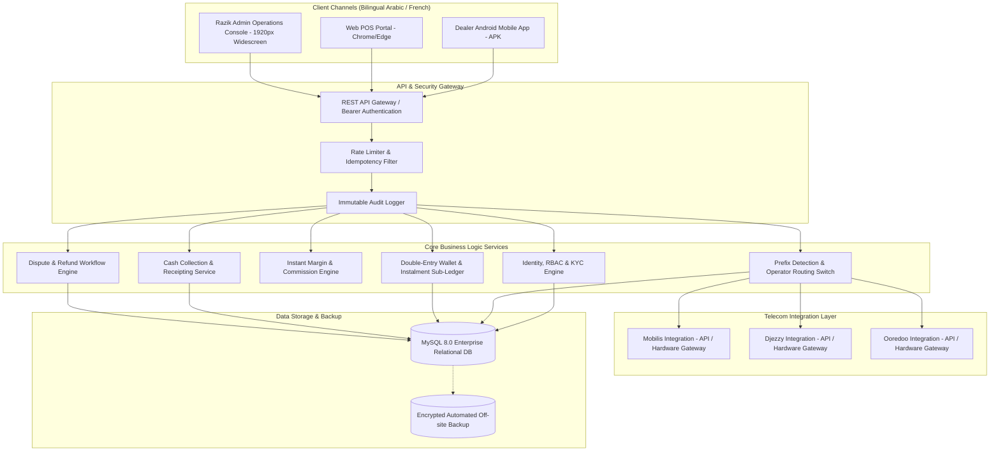
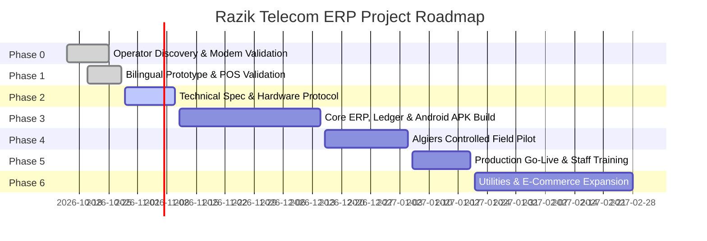

# Commercial & Technical Project Proposal

**Project:** Razik Telecom Next-Generation Telecom Credit Distribution ERP & Multi-Channel B2B POS Platform  
**Document Code:** PROP-RAZIK-2026-V1  
**Date:** October 28, 2026  
**Client:** Razik Telecom (Algiers, Algeria)  
**Prepared By:** SaNDS Lab Middle East W.L.L  
**Reference Document:** `docs/Razik_Telecom_Detailed_ERP_Scoping_Report_v0.1.pdf`  
**Classification:** Commercial-in-Confidence  

---

## 1. Executive Summary

### 1.1 Context & Opportunity
Razik Telecom is an established Algiers-based B2B distributor of prepaid mobile recharge credit across Algeria’s three licensed national telecom operators:
* **Mobilis** (ATM - Algérie Télécom Mobile)
* **Djezzy** (Optimum Telecom Algérie)
* **Ooredoo** (Wataniya Télécom Algérie)

Currently, Razik Telecom operates primarily through owner-driven manual processes. Recharge orders from retail kiosks, grocery shops, and cybercafés are fulfilled manually, and customer credit is settled under post-sale instalment and physical cash collection arrangements.

While this hands-on model has successfully established Razik Telecom's brand and merchant network, it creates critical operational ceilings:
1. **Scalability Constraints:** The owner is the sole operator processing recharges, creating response delays and limiting peak-hour transaction volume.
2. **Credit & Cash Exposure:** Post-sale credit extension without automated hard/soft credit limits creates cash flow lag and reconciliation vulnerabilities.
3. **Lack of Multi-Channel Tooling:** Retail merchants lack high-speed, self-service POS interfaces (Android mobile app, desktop web terminal) with automated operator detection.
4. **Single-Point of Failure:** Lack of multi-role segregation, automated operator balance alerts, and auditable collection receipts.

### 1.2 Proposed Vision
**SaNDS Lab Middle East W.L.L** proposes the design, turnkey engineering, and staged deployment of the **Razik Telecom Multi-Channel ERP & B2B Distribution Platform**. 

The system transitions Razik Telecom from manual dispatching to an automated, auditable, high-concurrency transaction switch:
* **For Retail Agents / Dealers:** High-speed bilingual (Arabic RTL / French) Mobile App (Android APK) and Web POS Terminal enabling instant recharges within 3 seconds, instant margin calculations, and transparent digital debt/instalment statements.
* **For Razik Telecom Management:** Enterprise Widescreen Web Operations Center providing real-time operator wholesale quota monitoring, automated margin tiering, KYC agent onboarding, physical cash collection reconciliation with tamper-proof numbered receipts, and dispute resolution with instant wallet reversal.
* **Extensible Architectural Foundation:** Designed from Day 1 with clean domain boundaries to incorporate utility payments (Sonelgaz electricity/gas, Algérienne Des Eaux - ADE water) and B2B physical electronics & accessories commerce without restructuring the core ledger.

---

## 2. Business Objectives & Success Metrics

| Strategic Objective | Current Baseline | Target with Razik Telecom ERP | Business Impact |
| :--- | :--- | :--- | :--- |
| **Transaction Processing Time** | 2 – 5 minutes (manual intervention) | < 3 seconds (automated routing) | **50x capacity expansion**; zero manual intervention for standard recharges |
| **Operator Selection Accuracy** | Manual operator selection (error-prone) | Automatic prefix detection (`06` Mobilis, `07` Djezzy, `05` Ooredoo) | **0% operator routing errors**; eliminates misdirected credit |
| **Credit & Receivables Risk** | Unmonitored informal balance accumulation | Hard/Soft credit facilities with automated sales freeze on overdue limits | **Eliminates bad debt leakage**; enforces discipline on instalment plans |
| **Cash Collection Verification** | Manual paper/informal records | Numbered immutable digital receipts, batch allocation & daily reconciliations | **100% auditability** of physical collector routes |
| **Stockout Prevention** | Manual balance checks; risk of sudden dry-out | Real-time threshold alerts (Low Balance Warnings) per operator | **Zero service downtime**; proactive quota replenishment |

---

## 3. High-Level Solution Architecture

The proposed system adopts a modern, modular, resilient architectural design suited for Algeria’s infrastructure constraints (offline resilience, bilingual display, hybrid server deployment).



---

## 4. Functional Scope Breakdown

Based on the detailed scoping baseline, the system comprises six (6) integrated functional pillars:

### Pillar 1: Platform Foundation, Identity & Access Control
* **Self-Service Retailer Onboarding:** Registration portal capturing merchant business details, Trade Register (Registre du Commerce), tax ID (NIF/NIS), store photo, and Wilaya/Commune location.
* **Owner Approval Workflow:** No account can transact until formally vetted, given credit limits, and approved by Razik Telecom.
* **Role-Based Access Control (RBAC):**
  * `Super Admin / Owner`: Unrestricted configuration, financial overrides, wallet adjustments, and reporting.
  * `Dealer / Kiosk Agent`: Transaction initiation, personal wallet ledger, debt balance, customer receipt generation.
  * `Field Cash Collector (Future-ready)`: Route-specific payment collection logging, counter-signature receipts, zero config access.
  * `Customer Support / Operations`: Ticket handling, transaction trace inspection, masked sensitive credentials.
* **Security & Session Management:** JWT session tokens, configurable session timeouts, brute-force protection, and IP/device fingerprinting.

### Pillar 2: High-Speed Telecom Recharge Engine
* **Instant Prefix Normalization & Auto-Detection:**
  * `06` / `+213 6`: Automatically routes to **Mobilis**
  * `07` / `+213 7`: Automatically routes to **Djezzy**
  * `05` / `+213 5`: Automatically routes to **Ooredoo**
* **Instant Commercial Margin Model:**
  * System calculates wholesale debit and merchant profit live on screen prior to submission.
  * *Example (5% commission on 100 DZD recharge):* Customer receives 100 DZD; Dealer wallet debited 95 DZD; Dealer retains 5 DZD instant cash margin.
* **Transaction State Machine:**
  * Strict transaction lifecycles: `INITIATED` $\to$ `VALIDATING` $\to$ `PENDING_OPERATOR` $\to$ `SUCCESS` / `FAILED` / `EXCEPTION`.
  * **Idempotency Guarantee:** Prevents double-charging if connection drops or dealer double-clicks "Submit".
  * **Controlled Pending Queue:** Unconfirmed operator timeouts do not fail silently; they enter an active watchdog queue for verification.

### Pillar 3: Agent Credit, Instalment & Cash Collection Sub-Ledger
* **Double-Entry Balance Accounting:** Every financial movement creates an auditable credit and debit entry with before/after balance snapshots.
* **Flexible Commercial Terms:** Support for both Pre-Funded (cash before recharge) and Post-Sale / Credit Limit models with soft/hard limits.
* **Instalment Scheduling & Overdue Blocking:** 
  * Schedule split payments with defined due dates.
  * Automated alerts and conditional transaction lockouts when credit exposures exceed agreed thresholds.
* **Physical Cash Collection Register:**
  * Collector visits merchant $\to$ logs cash received with payment proof $\to$ issues an unalterable numbered digital receipt.
  * Allocation engine applies funds against oldest open invoice/recharge batch.
  * Strict reversal protocols: Errors require authorized contra-entries with documented justification.

### Pillar 4: Operator Wholesale Balance Management & Reconciliation
* **Live Wholesale Quota Monitor:** Visual tracking of bulk credit pools purchased from Mobilis, Djezzy, and Ooredoo.
* **Multi-Tier Low Balance Alerts:**
  * *Warning Level:* Alerts administrator when operator balance falls below 20%.
  * *Critical Lockout:* Prevents orders when operator reserves cannot clear request, redirecting dealer with clear notification.
* **Discrepancy Reconciliation Engine:** End-of-day comparison between internal transactional logs and operator consumption statements.

### Pillar 5: Bilingual User Experience & Multi-Channel Delivery
* **Native Arabic (RTL) & French/English (LTR):** Complete contextual localization across all screens, receipts, and alert messages.
* **High-Density Web Operations Console:** Tailored for 1920px widescreen desktop monitors in distribution offices, featuring quick KPI analytics, real-time transaction streams, and one-click actions.
* **Dealer Android Application:** Lightweight APK optimized for low-bandwidth cellular connections across Algerian Wilayas, featuring quick-action tiles and thermal Bluetooth receipt printing support.

### Pillar 6: Future Foundation (Bill Utilities & E-Commerce Ready)
* Architectural schema reservations for **Sonelgaz** (Electricity/Gas reference bill payments) and **ADE** (Algérienne Des Eaux water payments).
* Modular database isolation for physical accessories (chargers, cables, handsets) with inventory SKU tracking, wholesale batch pricing, and physical store delivery.

---

## 5. Current Development Baseline (Proof of Capability)

Unlike proposals starting from zero, **SaNDS Lab Middle East W.L.L has already engineered and demonstrated a functional, operational baseline** for Razik Telecom:

```
========================================================================================
CURRENT STATUS OF DELIVERED ASSETS (As of October 28, 2026):
========================================================================================
[x] Relational Database:    MySQL 8.0 schema with 9 core tables & Algerian seed data
[x] REST API Backend:       PHP 8.2 API with 8 production endpoints (Stats, Recharges,
                            Dealers, Operators, Wallets, Complaints/Refunds)
[x] Web Operations Portal:  React 18 + Vite Widescreen (1920px) Dashboard with
                            Algerian Art Emblem, Algiers Timezone Clock, and RTL support
[x] POS Simulator:          Integrated Smartphone POS Simulator with instant commission
                            calculator and prefix detection
[x] Mobile Codebase:        React Native / Expo mobile application scaffold prepared
========================================================================================
```

This active foundation significantly de-risks the project, reduces timeline uncertainties, and ensures that development proceeds from validated code.

---

## 6. Phased Implementation Roadmap & Deliverables

We recommend a structured six-phase execution to guarantee zero downtime and maximum security:



### Detailed Phase Breakdown

#### Phase 0: Discovery, Server Inspection & Integration Proof (Completed / Baseline)
* Inspection of existing local server environment, operator SIM/modem infrastructure, and commercial agreements.
* Validation of operator connectivity feasibility (Direct API vs. GSM multi-SIM hardware gateway).

#### Phase 1: Bilingual Prototype & Interactive POS Validation (Completed / Baseline)
* Delivered widescreen management portal and mobile POS simulator.
* Approved business logic for instant commission deduction and Algerian telecom prefix detection.

#### Phase 2: Technical Specification & Operator Gateway Architecture (Weeks 1 – 2)
* Formalized API specifications and integration connectors for Mobilis, Djezzy, and Ooredoo.
* Database hardening for high-concurrency transaction locking.
* Security protocol specification (data encryption, SMS OTP 2FA rules).

#### Phase 3: Core ERP Build & Android Mobile APK Packaging (Weeks 3 – 7)
* Finalization of the full sub-ledger: instalment plans, debt ageing buckets (30/60/90 days), and cash collection receipts.
* Packaging of native **Android APK** using Expo / EAS build tools.
* Field thermal Bluetooth printer integration for physical recharge receipts.
* Integration of operator balance automatic polling and low-balance push alerts.

#### Phase 4: Controlled Pilot in Algiers (Weeks 8 – 10)
* Deployment of Android APK to 10 – 15 select Razik Telecom retail kiosks in Algiers.
* Parallel running with current manual process to verify transaction speed, reliability, and reconciliation precision.
* Incident review, network drop resilience tuning, and user feedback incorporation.

#### Phase 5: Commercial Launch, Deployment & Handover (Weeks 11 – 12)
* Full platform deployment on Razik Telecom local server / secured private cloud.
* Comprehensive training for the owner and future operations/finance staff.
* Delivery of Arabic and French operator user manuals and quick-reference laminated POS cheat-sheets.
* Operational handover and initiation of the post-launch warranty period.

#### Phase 6: Strategic Expansion (Post-Launch Phase)
* Sonelgaz (electricity/gas) and ADE (water) utility bill inquiry and payment module.
* Inter-wilaya transport voucher integration.
* B2B accessories catalog and physical inventory dispatch tracking.

---

## 7. Technology Stack & Deployment Model

| Layer | Technology Selected | Rationale for Selection |
| :--- | :--- | :--- |
| **Backend API** | PHP 8.2 (RESTful Architecture) | High performance, ultra-lightweight, natively supported on local Algerian office servers and shared/dedicated hosts without heavy daemon dependencies. |
| **Database** | MySQL 8.0 Enterprise Relational | ACID compliant transactions, row-level locking for wallet debits, foreign key integrity, double-entry auditability. |
| **Admin Operations** | React 18, Vite, Modern Vanilla CSS | 1920px widescreen responsive dashboard, zero-bloat styling, native Arabic RTL support, instant local caching. |
| **Retailer Mobile App**| React Native / Expo | Cross-platform codebase delivering native Android APK with future iOS capability; supports offline caching and Bluetooth thermal printers. |
| **Deployment Target**| Local Server in Office with Cloud Sync | Fulfills client requirement of holding balance on internal server while enabling secured remote dealer connectivity via reverse SSL proxy. |
| **Security Standards** | AES-256 at rest, TLS 1.3 in transit | Operator credential masking, bcrypt password hashing, IP whitelist option for administrative access. |

---

## 8. Controls, Risk Management & Mitigations

| Risk ID | Identified Risk | Impact | Proposed Architectural Mitigation |
| :--- | :--- | :--- | :--- |
| **R-01** | Telecom operator connection drops or network timeouts during recharge. | High | **Idempotency keys & Managed Pending Queue:** Recharges are assigned unique tracking tokens. Dropped calls remain in `PENDING` without double-debiting until verified by operator status query. |
| **R-02** | Retailer debt accumulates beyond recoverable limits. | High | **Automated Hard/Soft Credit Limits:** System enforces hard stop on recharges when outstanding debt exceeds approved credit limit or missed instalment due dates. |
| **R-03** | Cash collector misappropriation or unallocated cash disputes. | High | **Tamper-Proof Sequential Receipts:** Every cash collection generates an unalterable, time-stamped digital receipt; collector signature and agent SMS confirmation. |
| **R-04** | Local server hardware failure or data corruption. | High | **Automated Dual-Backups:** Daily encrypted snapshots of MySQL database pushed automatically to redundant local storage and off-site cloud storage. |
| **R-05** | Mobile number portability routing error. | Medium | Maintained operator prefix table with manual operator override toggle on the POS screen if a customer ported their number. |

---

## 9. Roles & Responsibilities Matrix (RACI)

| Project Milestone / Activity | Razik Telecom (Client) | SaNDS Lab Middle East (Engineering) |
| :--- | :---: | :---: |
| Provision of Operator Contracts & Connection Credentials | **Accountable (A)** | Informed (I) |
| Local Server Hardware, Power Backup & Internet Access | **Responsible (R)** | Consulted (C) |
| Architecture, Software Engineering & Database Design | Consulted (C) | **Responsible / Accountable (R/A)** |
| Android Mobile Application APK Compilation & Build | Informed (I) | **Responsible / Accountable (R/A)** |
| Business Rules Definition (Credit limits, instalment terms, commissions) | **Accountable (A)** | Consulted (C) |
| Pilot Testing with Algiers Retail Kiosks | **Accountable (A)** | **Responsible (R)** |
| End-User Acceptance Testing (UAT) Sign-off | **Accountable (A)** | Consulted (C) |
| System Training & Administration Documentation | Consulted (C) | **Responsible / Accountable (R/A)** |

---

## 10. Commercial Investment & Milestone Payment Structure

*Note: Indicative project milestone quotation tailored to the scoped deliverables (Phases 1 through 5).*

| Milestone | Milestone Deliverables Description | Target Completion | Invoicing Share |
| :---: | :--- | :---: | :---: |
| **M1: Contract & Inception** | Formal project kickoff, scoping sign-off, architecture lock, and staging server setup. | Week 1 | **20%** |
| **M2: Core ERP & Transaction Engine** | Functional REST API, complete sub-ledger, cash collection register, and admin web console. | Week 4 | **30%** |
| **M3: Mobile Application & Operator Integration** | Delivery of Android APK, operator routing gateway, thermal printing integration, and end-to-end sandbox testing. | Week 8 | **25%** |
| **M4: Pilot Deployment & Acceptance** | Successful Algiers kiosk pilot (minimum 1,000 live recharges without discrepancy), UAT sign-off. | Week 10 | **15%** |
| **M5: Production Launch & Handover** | Live deployment on production server, staff training, documentation, and warranty commencement. | Week 12 | **10%** |
| **Total** | **Turnkey Platform Delivery** | **12 Weeks** | **100%** |

### Post-Launch Service & Support Package (Included & Extended)
* **Standard Warranty (90 Days Included):** Full defect correction, performance monitoring, and critical security patch updates.
* **Optional Annual Maintenance Contract (AMC):**
  * 99.5% uptime monitoring and database performance optimization.
  * Ongoing operator prefix table updates and API adaptation.
  * Priority 24/7 emergency incident support for operator disconnection.

---

## 11. Proposal Acceptance & Sign-off

This proposal represents a complete solution baseline transitioning Razik Telecom into a dominant, technologically-advanced telecom credit distributor in Algiers.

### Client Authorization:
**For Razik Telecom:**

Name: \_\_\_\_\_\_\_\_\_\_\_\_\_\_\_\_\_\_\_\_\_\_\_\_\_\_\_\_\_\_\_  
Title: Owner & Managing Director  
Signature: \_\_\_\_\_\_\_\_\_\_\_\_\_\_\_\_\_\_\_\_\_\_\_\_\_\_\_\_  
Date: \_\_\_\_\_\_\_\_\_\_\_\_\_\_\_\_\_\_\_\_\_\_\_\_\_\_\_\_\_\_\_  

### Engineering Delivery Lead:
**For SaNDS Lab Middle East W.L.L:**

Name: \_\_\_\_\_\_\_\_\_\_\_\_\_\_\_\_\_\_\_\_\_\_\_\_\_\_\_\_\_\_\_  
Title: Lead Technical Architect  
Signature: \_\_\_\_\_\_\_\_\_\_\_\_\_\_\_\_\_\_\_\_\_\_\_\_\_\_\_\_  
Date: \_\_\_\_\_\_\_\_\_\_\_\_\_\_\_\_\_\_\_\_\_\_\_\_\_\_\_\_\_\_\_  
